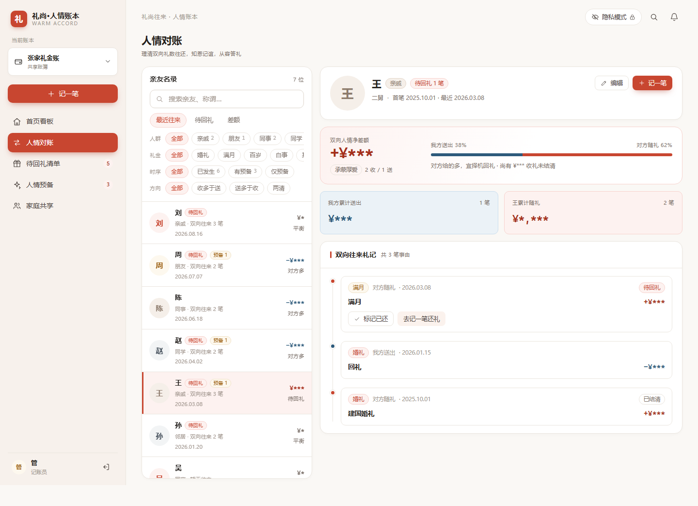
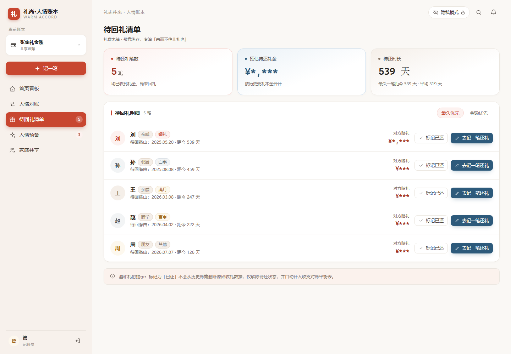
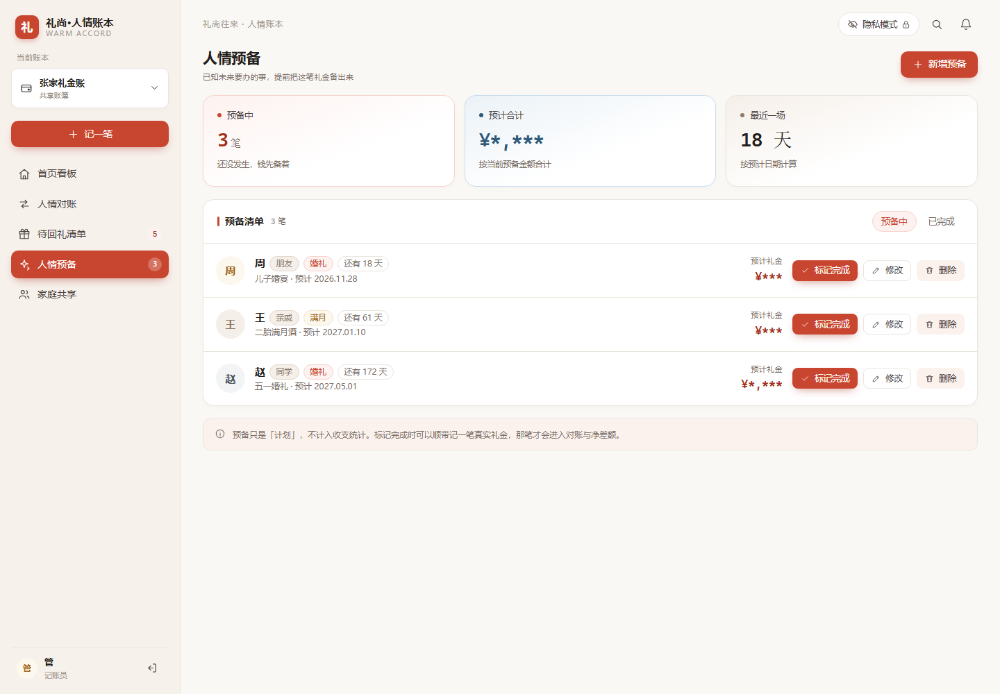
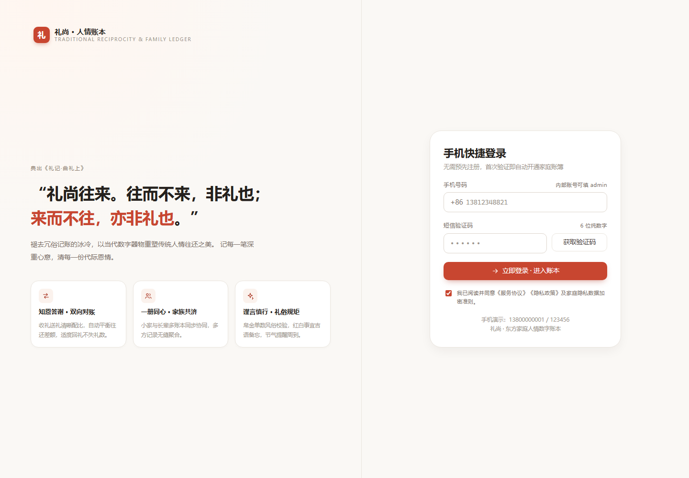
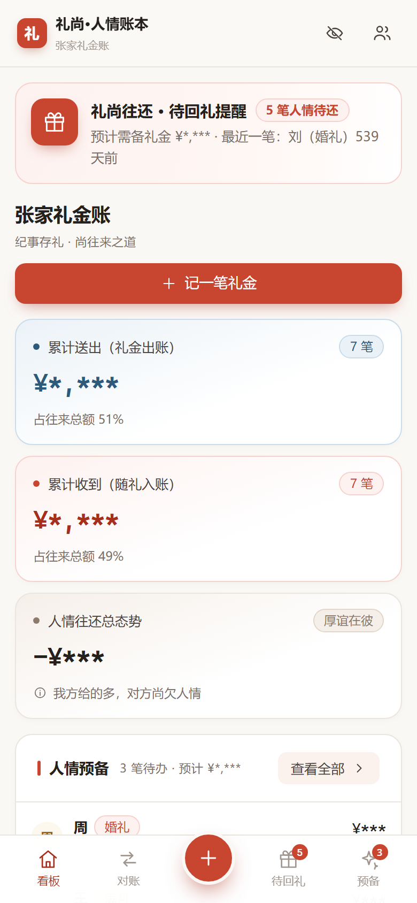
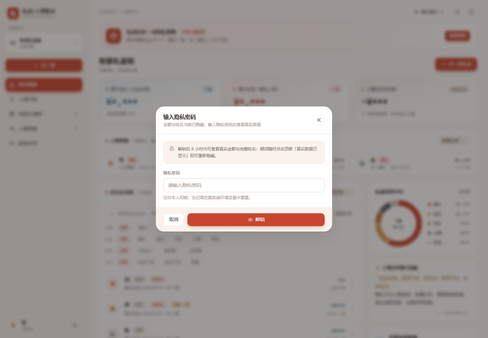
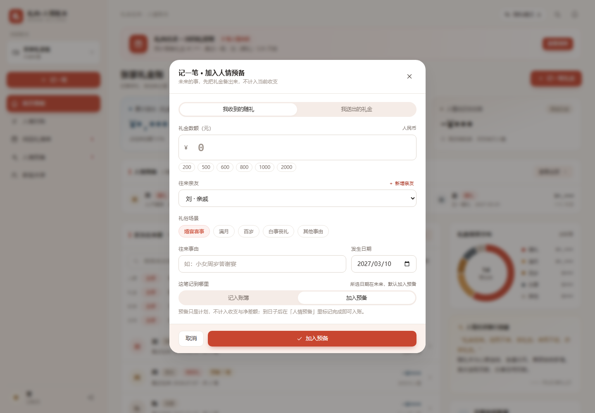

# 礼金账本（giftdeal）

以人为中心的双向礼金对账应用。记录家庭成员与某位亲友之间的送出 / 收到礼金，支持按人聚合、净差额计算、待回礼筛选、账本共享；另有「人生大事」时间线，把一场婚礼、一次满月收的几十笔礼金汇总成一张单子。

**当前状态**：全栈 MVP 已完成。接口冒烟 **69 项全过**，前端按 Warm Accord 设计系统实现并通过浏览器交互回归。界面默认开启隐私遮罩。

<p align="center">
  
</p>

---

## 界面

| 页面 | 路径 | 说明 |
|---|---|---|
| 登录 | `/login` | 手机号 + 验证码，首次验证自动开通账簿 |
| 首页看板 | `/` | 待回礼横幅、收发合计、净差额、人情预备区块、亲友往来册（人群 / 礼金 / 时序 / 方向四维筛选）、场景分布 |
| 人情对账 | `/contacts` · `/contacts/[id]` | 名录 + 单人双向往来时间线 |
| 人生大事 | `/events` · `/events/[id]` | 以个人为中心的时间线：婚礼、满月、寿宴等，每场汇总收礼总额、笔数、参与亲友与明细 |
| 待回礼清单 | `/pending` | 待还时长排序、逐笔标记已还、行内去记还礼 |
| 人情预备 | `/plans` | 未来已知的红白事提前备礼：新增 / 修改 / 删除 / 完成（可同时记一笔），首页有汇总区块 |
| 家庭共享 | `/ledger` | 账本信息、成员、邀请链接、多账本切换 |
| 邀请落地 | `/invite/[token]` | 接受邀请加入账本 |
| 服务协议 / 隐私政策 | `/legal/terms` · `/legal/privacy` | 静态条款页，登录页底部可进入 |

<table>
<tr>
<td width="50%"></td>
<td width="50%"></td>
</tr>
<tr>
<td width="50%"></td>
<td width="50%"></td>
</tr>
</table>

**移动端**

<p align="center">
  
</p>

**交互细节**

<table>
<tr>
<td width="50%"></td>
<td width="50%"></td>
</tr>
</table>

> 截图均为演示数据，金额与姓名按隐私模式遮罩。

设计沿用原型的「宣纸底 + 朱柿赤（收礼）/ 青黛墨蓝（送礼）」体系；净差额不用红绿涨跌，改用「承蒙厚爱 / 厚谊在彼 / 往还平衡」三种措辞。桌面三栏、平板图标轨、手机底部导航三套布局。

---

## 技术栈

| 组件 | 版本 | 说明 |
|---|---|---|
| Next.js | 16.4.6 | App Router + Route Handlers |
| Prisma | **7.10.1（已固定）** | npm 上 `latest` 是 8.0.0-rc，Better Auth 的 Prisma adapter 尚不支持 8 |
| PostgreSQL | Neon | 运行时 pooled 串，迁移直连串 |
| Better Auth | 1.7.19 | 手机号 + 短信验证码 |
| Zod | 4.6.7 | 入参校验 |
| Vercel | — | 部署目标 |

---

## 快速开始

### 方式一：零依赖本地演示（推荐，不需要 Docker / Neon）

```bash
npm install
npm run dev:local     # 同时起本地演示数据库 + 开发服务
```

> `npm install` 会自动执行 `prisma generate`。Prisma 7 的客户端生成在 `src/generated/`（不入库），
> 所以新克隆的仓库必须先装依赖再启动，不能跳过这一步。

打开 <http://localhost:3000>，用 `13800000001` / 验证码 `123456` 登录。

> **手机访问**：确保手机和电脑连同一个 Wi-Fi，用电脑的局域网 IP 打开，例如 `http://192.168.0.101:3000`。
> 查 IP：Windows `ipconfig` 看 WLAN 的 IPv4 地址；macOS/Linux `ifconfig | grep inet`。
> 项目已开启 `ALLOW_LAN_ACCESS=true`，会自动把本机内网 IP 加进认证白名单；生产环境请关掉。

首次运行需要建表并灌数据（只需一次）：

```bash
npm run db:local          # 另开一个终端起数据库
npx prisma migrate deploy
npx prisma db seed
```

演示库基于 PGlite（WASM 版 Postgres，走标准 wire protocol），数据存在 `.localdb/`，重启不丢；删掉该目录即可清空重来。

### 方式二：接真实 Postgres / Neon

```bash
cp .env.example .env      # 填 DATABASE_URL / DIRECT_URL
npm install
npx prisma migrate deploy
npx prisma db seed
npm run dev
```

**登录方式**

| 方式 | 输入 | 说明 |
|---|---|---|
| 手机验证码 | `13800000001` + 验证码 `123456` | 需 `OTP_ALLOW_FIXED_CODE=true` |
| 内部账号 | 手机号框直接填 `admin` | 无需验证码，直接进入；需 `ALLOW_ADMIN_LOGIN=true` |

> 手机号框只接受 11 位数字或 `admin` 这一个字母组合，其他字母和不合规号码会被输入框挡掉。
>
> **接真实短信**：`SMS_PROVIDER=tencent` 并填 5 个 `TENCENT_SMS_*` 变量即可，步骤见
> [`docs/05-sms-setup.md`](docs/05-sms-setup.md)。代码已实现腾讯云 SendSms（零依赖，手写 TC3 签名）。

### 隐私模式（敏感信息默认遮罩）

界面默认**不显示真实金额和完整姓名**：

- 金额按位数显示星号：`¥4,300` → `¥*,***`，`¥400` → `¥***`，`¥20` → `¥**`
- 人名只保留姓氏：`王建国` → `王`（复姓保留两字）
- 备注里的数字同样打码；手机号始终打码

点顶栏的「隐私模式」按钮 → 输入隐私密码（默认 `331633`，可用环境变量 `PRIVACY_PASSWORD` 覆盖）→ 解锁 8 小时；再点「真实数据已显示」即可随时重新隐藏。密码只存在服务端，不会进入前端打包产物；连续输错 5 次锁定 1 分钟。解锁状态由服务端 httpOnly Cookie 判定，前端改不了。

> 这是**展示层**隐私模式，防的是旁人窥屏；接口本身仍受登录会话与账本成员校验保护。
> 生产环境把 `ALLOW_ADMIN_LOGIN` 设为 `false`，内部账号通道即整体关闭。

> 本地没有 Postgres？用 Docker 一行起一个：
> `docker run -d --name giftdeal-pg -e POSTGRES_USER=giftdeal -e POSTGRES_PASSWORD=giftdeal -e POSTGRES_DB=giftdeal -p 5432:5432 postgres:16`

---

## 常用命令

| 命令 | 作用 |
|---|---|
| `npm run dev:local` | 本地演示数据库 + 开发服务（一条命令） |
| `npm run db:local` | 只起本地演示数据库（127.0.0.1:55432） |
| `npm run dev` | 开发服务（需已有数据库在跑） |
| `npm run build` | `prisma generate` + 生产构建 |
| `npm run typecheck` | `tsc --noEmit` |
| `npm test` | 纯函数单元测试（日期 / 金额 / 遮罩） |
| `npm run db:deploy` | 应用迁移（生产 / CI） |
| `npm run db:seed` | 写入演示数据（幂等） |
| `npm run db:seed -- --reset` | 先清空演示数据再写入 |
| `npm run smoke` | 接口冒烟测试（需服务已启动） |

---

## 目录

```
prisma/
  schema.prisma          数据模型
  migrations/            初始迁移（含 contact 部分唯一索引）
  seed.ts                演示数据
src/
  app/
    (app)/               登录后的应用外壳
      page.tsx           首页看板
      contacts/          人情对账（名录 + 单人详情）
      pending/           待回礼清单
      ledger/            家庭共享与账本管理
    login/               登录页
    invite/[token]/      邀请落地页
    api/auth/[...all]    Better Auth 挂载
    api/v1/              业务接口
    globals.css          设计令牌 + 组件样式 + 响应式
  components/
    providers.tsx        Auth / Ledger / Toast 上下文
    app-shell.tsx        侧栏、账本切换、底部导航
    record-dialog.tsx    记一笔弹层
    contact-list.tsx     亲友名录
    contact-detail.tsx   对账详情
    ui.tsx / icons.tsx   基础组件与图标
  lib/
    api.ts               请求封装（信封、X-Ledger-Id、401）
    auth-client.ts       better-auth 客户端
    format.ts            金额 / 日期 / 场景配色
    types.ts             与 DTO 对应的类型
  server/
    auth.ts              Better Auth 配置（phoneNumber 插件）
    db.ts                PrismaClient + pg adapter
    guards/              会话与账本成员校验
    services/            业务逻辑
    validators/          zod 入参校验
    http/                统一信封、错误码、路由包装
  generated/prisma/      Prisma 生成产物（不入库）
docs/
  01-data-model.md       数据模型与删除策略
  02-api-contract.md     完整接口契约
  03-engineering.md      工程结构、认证流程、部署、前端实现
  04-deploy-checklist.md 上线检查清单（环境变量、验证、回滚）
  05-sms-setup.md        接入腾讯云短信的完整步骤
scripts/smoke.mjs        接口冒烟测试
```

---

## 接口速览

认证走 Better Auth（前端用 `authClient`，不要手拼路径）：

```ts
import { createAuthClient } from "better-auth/react";
import { phoneNumberClient } from "better-auth/client/plugins";

export const authClient = createAuthClient({ plugins: [phoneNumberClient()] });

await authClient.phoneNumber.sendOtp({ phoneNumber: "+8613800000001" });
await authClient.phoneNumber.verify({ phoneNumber: "+8613800000001", code: "123456" });
```

业务接口全部在 `/api/v1`，**账本内请求必须带 `X-Ledger-Id` 请求头**：

| 资源 | 接口 |
|---|---|
| 用户 | `GET /me`、`PATCH /me` |
| 账本 | `GET/POST /ledgers`、`GET/PATCH /ledgers/{id}`、`GET /overview` |
| 成员 | `DELETE /ledgers/{id}/members/me`（退出）、`POST /ledgers/{id}/transfer`（转让管理员） |
| 导出 | `GET /export`（需先解锁隐私模式） |
| 联系人 | `GET/POST /contacts`、`GET/PATCH/DELETE /contacts/{id}`、`GET /contacts/{id}/settlement` |
| 记录 | `GET/POST /records`、`GET/PATCH/DELETE /records/{id}`、`POST /records/{id}/settle`、`POST /records/{id}/unsettle` |
| 人生大事 | `GET/POST /events`、`GET/PATCH/DELETE /events/{id}` |
| 待回礼 | `GET /pending-returns` |
| 人情预备 | `GET/POST /plans`、`GET/PATCH/DELETE /plans/{id}`、`POST /plans/{id}/complete` |
| 隐私模式 | `GET /privacy/status`、`POST /privacy/verify`、`POST /privacy/lock` |
| 邀请 | `POST /invites`、`GET/DELETE /invites/{token}`、`POST /invites/{token}/accept` |

响应统一为 `{ ok: true, data }` / `{ ok: false, error: { code, message } }`。
完整字段、错误码、示例见 [`docs/02-api-contract.md`](docs/02-api-contract.md)。

---

## 演示数据

| 账本 | 联系人 | 记录 | 送出 | 收到 | 净差额 | 待回礼 |
|---|---|---|---|---|---|---|
| 张家礼金账 `led_zhang` | 11 | 47 | 4300 元 | 26100 元 | **+21800 元** | 5 笔 / 3000 元 |
| 李家礼金账 `led_li` | 5 | 10 | 3400 元 | 4400 元 | **+1000 元** | 3 笔 / 3500 元 |

张家账本还带一条完整的人生大事时间线（6 场）：

| 日期 | 事件 | 收礼 | 笔数 | 参与亲友 |
|---|---|---|---|---|
| 2018-05-20 | 我的婚礼 | 8200 元 | 8 | 8 |
| 2019-08-16 | 长子满月 | 2800 元 | 5 | 5 |
| 2019-11-24 | 长子百岁 | 1700 元 | 4 | 4 |
| 2022-03-12 | 次女满月 | 2900 元 | 5 | 5 |
| 2022-06-20 | 次女百岁 | 1700 元 | 4 | 4 |
| 2025-09-08 | 父亲白事 | 4700 元 | 7 | 7 |

张家账本另有 **3 笔人情预备**（共 2600 元）：周敏儿子婚宴 800 元、王建国二胎满月 600 元、赵磊五一婚礼 1200 元。预备金额**不计入**上面的收支与净差额。

- 两个用户互为对方账本成员：`+8613800000001`（张伟，张家 OWNER）、`+8613800000002`（李娜，李家 OWNER）
- 记录覆盖四种结清状态：未结清、手动结清、关联结清（送出记录结清收礼）
- ID 固定（`con_a_001`、`rec_a_013`…），前端可直接硬编码

---

## 部署（Vercel + Neon）

完整清单见 [`docs/04-deploy-checklist.md`](docs/04-deploy-checklist.md)，含环境变量表、上线后逐项验证与回滚方式。要点：

1. Neon 建库，复制 **pooled** 串 → `DATABASE_URL`，**direct** 串 → `DIRECT_URL`。
2. Vercel 环境变量：上面两个 + `BETTER_AUTH_SECRET`、`BETTER_AUTH_URL`（生产域名）、`NEXT_PUBLIC_APP_URL`（邀请链接域名）、`SMS_PROVIDER`。
3. Build Command：`npm run build`（`postinstall` 内含 `prisma generate`）。
4. 迁移在本地或 CI 执行 `npx prisma migrate deploy`，**不要**放进 build（并发构建会重复执行）。
5. 生产环境**不要**设置 `OTP_ALLOW_FIXED_CODE` 和 `ALLOW_ADMIN_LOGIN`，否则任何人都能用固定验证码或 admin 账号登录。

---

## 已知边界

- 短信是 mock：验证码只打印在服务端日志，未接真实通道。
- 删除一律软删除：删联系人保留其礼金记录；删「用于结清的送出记录」会把对应收礼回退为待回礼。
- 记录创建后 `contactId` / `direction` 不可改（避免结清关系错乱），要改请删除后重建。
- 账本管理员不能直接退出，必须先转让给其他成员；账本本身不能删除。
- 隐私模式密码是全局共享的，且失败锁定在进程内（多实例部署下不严格）。
- 不做：微信登录、复杂 RBAC、审计日志、礼俗知识库。
