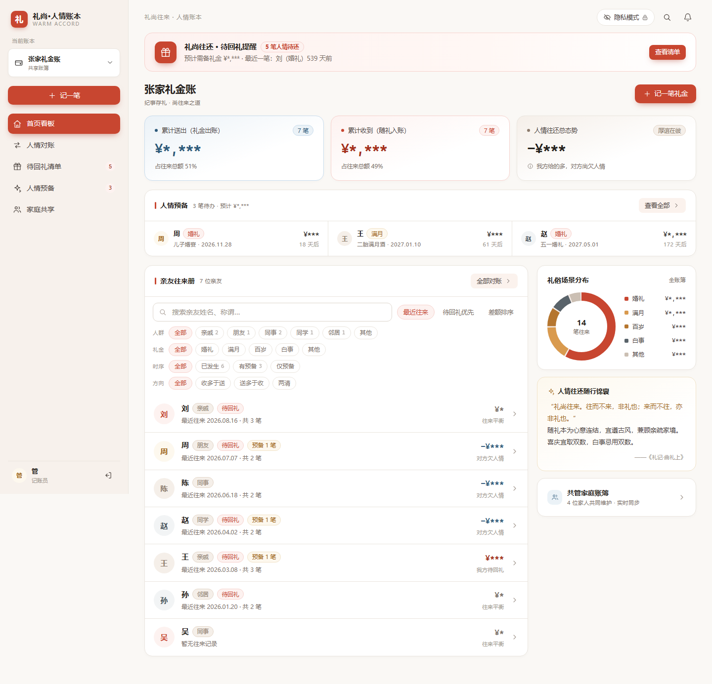

# 礼金账本（giftdeal）

以人为中心的**双向礼金对账**应用。记录一家与某位亲友之间的送出 / 收到礼金，按人聚合、算净差额、筛待回礼；再用人情预备与人生大事时间线，把「未来要还的礼」和「过去办过的事」都收在一处。

> 设计取向：礼金不是流水账，而是**关系账**。所以界面按「人」组织，金额默认遮罩，净差额不用红绿涨跌，而用「承蒙厚爱 / 厚谊在彼 / 往还平衡」三种措辞。

<p align="center">
  
</p>

---

## 目录

- [项目定位](#项目定位)
- [当前状态](#当前状态)
- [功能清单](#功能清单)
- [技术栈](#技术栈)
- [快速开始](#快速开始)
- [常用命令](#常用命令)
- [接口与目录](#接口与目录)
- [安全与生产配置](#安全与生产配置)
- [测试](#测试)
- [演示数据](#演示数据)
- [部署](#部署)
- [已知边界](#已知边界)
- [License](#license)

---

## 项目定位

| 场景 | 传统做法 | 这个项目 |
|---|---|---|
| 记礼金 | 纸质礼簿 / Excel | 手机号登录，多端随时记 |
| 还礼 | 翻旧账本回忆「他给过我多少」 | 按人实时算净差额与待回礼 |
| 家庭共记 | 一个人管一本账 | 账本共享，邀请家人共同维护 |
| 未来随礼 | 临时想不起来行情 | 人情预备：提前定金额与日期，到日子一键入账 |
| 办过的事 | 收礼单散落各处 | 人生大事时间线：一场婚礼 / 满月收了多少、都有谁 |

核心对象是**一次往来**（record）：方向（送出 / 收到）、金额（分）、场景、发生日期、亲友、可选的人生大事。所有统计都从记录实时聚合，不落冗余字段。

---

## 当前状态

全栈 MVP 已完成，并在 2026-11 做过一轮**生产安全加固**：

- 环境配置集中校验，生产环境禁用 mock 短信 / 固定验证码 / admin 快捷登录 / 局域网白名单
- 隐私密码不再回退默认值；失败锁定改为数据库计数（多实例一致）
- 短信发送失败会明确报错，不再「提示已发送但没收到」
- 修复 Drizzle 迁移后遗留的三处阻断性问题（详见提交记录）：会话查询缺关系、`updated_at` 无默认值、删除送出记录不回退结清
- 第二轮加固：生产运行禁止 `APP_ENV=test` 降级；IP 限流改数据库存储（多实例共享）；预备修改改为条件更新；限流键手机号 HMAC；非法 Cookie 不再 500；错误日志脱敏

自动化验证（本地实际运行结果，详见 [docs/06-testing.md](docs/06-testing.md)）：

| 套件 | 数量 | 命令 |
|---|---|---|
| 单元 + 服务层测试 | **112** | `npm test` |
| 接口冒烟 | **70** | `npm run smoke` |
| Playwright E2E | **11** | `npm run test:e2e` |

> 数字以当前 `main` 的实际输出为准；CI 会跑同样的三套。

---

## 功能清单

### 已实现且有自动化测试

| 功能 | 说明 | 覆盖 |
|---|---|---|
| 手机号验证码登录 | Better Auth `phoneNumber` 插件，首次验证自动开通账本 | E2E · 冒烟 |
| 多账本与家庭共享 | 创建 / 切换 / 重命名账本，邀请成员，转让管理员，退出 | E2E · 服务层 |
| 亲友管理 | 分组、搜索、排序、同名校验、软删除 | E2E · 服务层 |
| 双向礼金记录 | 收 / 送、金额、场景、日期、备注、分页、编辑、删除 | E2E · 冒烟 · 服务层 |
| 人情对账 | 单人全部流水、收送合计、净差额、待回礼笔数 | E2E · 服务层 |
| 待回礼清单 | 按拖延时长排序，逐笔结清，行内去记还礼 | E2E · 冒烟 |
| 关联结清 / 手动结清 / 取消结清 | 送出记录结清收礼；并发与重复结清有幂等保护 | 服务层 · 冒烟 |
| 人生大事时间线 | 事件汇总（收 / 送 / 净额 / 参与人数）、明细、软删除解绑 | E2E · 服务层 |
| 人情预备 | 增删改、完成并入账、仅标记完成、并发完成保护 | E2E · 冒烟 · 服务层 |
| 隐私遮罩与二次验证 | 金额 / 姓名 / 备注遮罩，HMAC Cookie 解锁 8 小时，失败锁定 | E2E · 服务层 |
| 数据导出 | 需先解锁隐私模式，导出全量 JSON | 冒烟 |
| 邀请加入账本 | 一次性链接、过期 / 撤销 / 已用状态、重复接受幂等 | E2E · 服务层 · 冒烟 |

### 已实现但尚未做真实环境验证

| 项 | 原因 |
|---|---|
| 腾讯云短信真实下发 | 需要企业资质、签名与模板审核；代码已实现并有单测，但未用真实号码跑通 |
| Neon / 自建 Postgres 生产部署 | 本地用 PGlite 验证；生产连接串、SSL、连接池参数需按实际环境确认 |
| Cloudflare Workers 构建 | 已保留 `cf:*` 脚本与 Neon WebSocket 驱动，但本次未验证部署 |
| 备份与恢复演练 | 文档给了步骤，尚未在真实库上演练 |

### 计划中

- 按人 / 按场景导出 CSV
- 账本级操作审计（谁改了哪笔）
- 礼俗知识提示（地区差异、单双数禁忌）

### 明确不做

- 微信登录 / 小程序端（当前只做 Web）
- 复杂 RBAC（只有 OWNER / MEMBER 两种角色）
- 多币种、汇率
- 账本物理删除（只能退出或改名）
- 在线支付、记账凭证 OCR

---

## 技术栈

| 层 | 选型 | 说明 |
|---|---|---|
| 框架 | Next.js 16.4（App Router） | Route Handlers 提供 `/api/v1` |
| 语言 | TypeScript 5.9 | 全量 strict |
| 数据访问 | **Drizzle ORM 0.45** | 运行时查询；服务层统一从 `src/server/db-drizzle.ts` 取 `db` |
| 数据库 | PostgreSQL（Neon / 自建 / 本地 PGlite） | 金额一律整数「分」；日期用 `DATE` |
| 迁移 | Prisma Migrate（仅 DDL） | `prisma/migrations/*.sql`，运行时不依赖 Prisma Client |
| 认证 | Better Auth 1.7 | 手机号 + 短信验证码，会话存库 |
| 校验 | Zod 4 | 入参在 route 层解析，服务层收结构化类型 |
| 测试 | Node Test Runner + PGlite / Playwright | 服务层跑真实 SQL；E2E 跑生产构建 |
| 部署 | Vercel + Neon（文档主线） | Workers 走 `cf:*` 脚本，未验证 |

> **为什么运行时用 Drizzle、迁移仍用 Prisma**：Prisma 7 的查询编译器是 WASM，Next 的 webpack 与 Workers 运行时都不兼容；Drizzle 是纯 TS，且能保留交互式事务。迁移继续用 Prisma Migrate，是因为 `prisma migrate deploy` 的版本管理与幂等性已经够用，没必要再造一套 DDL 工具。
>
> **数据库驱动**：Node 运行时用 `pg`（本地 PGlite、Docker Postgres、Neon TCP 都能连）；Cloudflare Workers 构建时由 `next.config.ts` 把 `@/server/db-drizzle` 别名到 `db-neon.ts`（Neon WebSocket）。

---

## 快速开始

### 方式一：零依赖本地演示（推荐）

```bash
npm install
npm run dev:local     # 起本地 PGlite 数据库 + Next 开发服务
```

首次运行需要建表并灌演示数据（只需一次）：

```bash
npm run db:local              # 另开终端，只起数据库（127.0.0.1:55432）
npx prisma migrate deploy     # 建表
npm run db:seed               # 演示数据
```

> 注意：`NEXT_PUBLIC_APP_URL` 等 `NEXT_PUBLIC_*` 变量由 Next 在**构建时内联**，运行时再改不生效；生产部署必须在构建环境里配置正确。
>
> 本地如果要跑构建产物（例如验证生产行为），请用测试构建：
> `npm run build:test` + `APP_ENV=test npm run start`。
> 严格生产构建（`npm run build`）在 `APP_ENV=test/development` 下会拒绝启动，这是设计上的安全边界。

打开 <http://localhost:3000>：

| 方式 | 输入 | 前提 |
|---|---|---|
| 手机验证码 | `13800000001` + `123456` | `.env` 里 `OTP_ALLOW_FIXED_CODE=true` |
| 内部账号 | 手机号框填 `admin` | `ALLOW_ADMIN_LOGIN=true`（仅非生产） |

> 手机访问：确保手机与电脑同一 Wi-Fi，用电脑局域网 IP 打开（如 `http://192.168.0.101:3000`）。
> `npm run dev:local` 启动时会打印全部局域网地址，选与手机同网段的那个；Next 自己打印的 `Network:` 可能选中 VMware 虚拟网卡，不一定对。
> 需要 `.env` 里 `ALLOW_LAN_ACCESS=true`：认证白名单与 Next dev 的跨源资源白名单会自动包含本机内网 IP。
> Next 16 默认拦截跨源 dev 资源（`/_next/*` 的 JS chunk、HMR），未放行时页面会一直转圈、但 HTML 和业务接口都是 200。`next.config.ts` 已在 dev 模式自动放行本机内网地址，生产构建不带此配置；额外来源可用 `NEXT_ALLOWED_DEV_ORIGINS`（逗号分隔的 hostname，不带协议/端口）补充。

PGlite 数据在 `.localdb/`，重启不丢；删掉目录即可清空。

### 方式二：接真实 Postgres / Neon

```bash
cp .env.example .env      # 填 DATABASE_URL / DIRECT_URL / BETTER_AUTH_SECRET
npm install
npx prisma migrate deploy
npm run db:seed           # 可选：演示数据
npm run dev
```

> 本地想用 Docker Postgres：
> `docker run -d --name giftdeal-pg -e POSTGRES_USER=giftdeal -e POSTGRES_PASSWORD=giftdeal -e POSTGRES_DB=giftdeal -p 5432:5432 postgres:16`

### 隐私模式

界面默认不显示真实金额与完整姓名：

- 金额按位数显示星号：`¥4,300` → `¥*,***`
- 人名只保留姓氏：`王建国` → `王`
- 备注里的数字同样打码

点顶栏「隐私模式」→ 输入密码 → 解锁 8 小时。开发环境默认密码 `331633`；**生产环境必须显式配置 `PRIVACY_PASSWORD`**，否则隐私验证直接返回 503，不会回退默认值。

---

## 常用命令

| 命令 | 作用 |
|---|---|
| `npm run dev:local` | 本地数据库 + 开发服务 |
| `npm run dev` | 只起开发服务（需数据库已在跑） |
| `npm run build` | `prisma generate` + 严格生产构建 |
| `npm run build:test` | 测试构建（CI / E2E 专用，带内联标记） |
| `npm run check:prod-guard` | 反向校验：生产构建拒绝 `APP_ENV=test` |
| `npm run start` | 启动生产构建 |
| `npm run typecheck` | `tsc --noEmit` |
| `npm test` | 单元 + 服务层测试（自动起临时 PGlite） |
| `npm run test:e2e` | Playwright E2E（内部自动构建测试产物） |
| `npm run smoke` | 接口冒烟（需服务已启动 + 已 seed） |
| `npm run db:deploy` | 应用迁移（生产 / CI） |
| `npm run db:seed` | 写入演示数据（幂等） |
| `npm run db:seed:reset` | 先清空演示数据再写入（破坏性） |
| `npm run cf:build` | Cloudflare Workers 构建（未验证） |

---

## 接口与目录

### 接口速览

认证走 Better Auth（前端用 `authClient`）：

```ts
await authClient.phoneNumber.sendOtp({ phoneNumber: "+8613800000001" });
await authClient.phoneNumber.verify({ phoneNumber: "+8613800000001", code: "123456" });
```

业务接口在 `/api/v1`，**账本内请求必须带 `X-Ledger-Id`**：

| 资源 | 接口 |
|---|---|
| 用户 | `GET /me`、`PATCH /me` |
| 账本 | `GET/POST /ledgers`、`GET/PATCH /ledgers/{id}`、`GET /overview` |
| 成员 | `DELETE /ledgers/{id}/members/me`、`POST /ledgers/{id}/transfer` |
| 导出 | `GET /export`（需先解锁隐私模式） |
| 联系人 | `GET/POST /contacts`、`GET/PATCH/DELETE /contacts/{id}`、`GET /contacts/{id}/settlement` |
| 记录 | `GET/POST /records`、`GET/PATCH/DELETE /records/{id}`、`POST /records/{id}/settle`、`POST /records/{id}/unsettle` |
| 人生大事 | `GET/POST /events`、`GET/PATCH/DELETE /events/{id}` |
| 待回礼 | `GET /pending-returns` |
| 人情预备 | `GET/POST /plans`、`GET/PATCH/DELETE /plans/{id}`、`POST /plans/{id}/complete` |
| 隐私模式 | `GET /privacy/status`、`POST /privacy/verify`、`POST /privacy/lock` |
| 邀请 | `POST /invites`、`GET/DELETE /invites/{token}`、`POST /invites/{token}/accept` |
| 健康检查 | `GET /health`（含数据库连通性） |

响应统一 `{ ok: true, data }` / `{ ok: false, error: { code, message } }`。完整字段与错误码见 [docs/02-api-contract.md](docs/02-api-contract.md)。

### 目录

```
prisma/
  schema.prisma          数据模型（与 Drizzle schema 一一对应）
  migrations/            DDL 迁移（含部分唯一索引、updated_at 默认值、throttle 表）
  seed.ts                演示数据
src/
  app/
    (app)/               登录后的应用外壳
      page.tsx           首页看板
      contacts/          人情对账
      events/            人生大事
      pending/           待回礼
      plans/             人情预备
      ledger/            家庭共享
    login/               登录页
    invite/[token]/      邀请落地页
    api/v1/              业务接口
  components/            应用外壳、弹层、名录、对账详情、基础 UI
  lib/                   请求封装 / 遮罩 / 格式化 / 日期 / 常量
  server/
    env.ts               环境变量与生产安全校验（唯一入口）
    auth.ts              Better Auth 配置
    db-drizzle.ts        数据库入口（Node → pg）
    db-neon.ts           Cloudflare Workers 用的 Neon 驱动
    privacy.ts           隐私解锁（HMAC Cookie + 数据库限流）
    throttle.ts          固定窗口限流（数据库）
    otp/                 短信通道（mock / 腾讯云）
    guards/              会话与账本成员校验
    services/            业务逻辑
    validators/          Zod 入参校验
    http/                统一信封、错误码、路由包装
  instrumentation.ts     生产启动自检
docs/
  01-data-model.md       数据模型与删除策略
  02-api-contract.md     完整接口契约
  03-engineering.md      工程结构、认证、配置、部署
  04-deploy-checklist.md 上线检查清单
  05-sms-setup.md        腾讯云短信接入
  06-testing.md          测试策略与运行方式
scripts/
  dev-db.mjs             本地 PGlite 服务
  smoke.mjs              接口冒烟
  e2e-db.mjs / e2e-app.mjs  E2E 专用数据库与应用进程
e2e/                     Playwright 用例
tests/                   服务层测试与 PGlite 夹具
```

---

## 安全与生产配置

### 环境分层（`APP_ENV`）

| 值 | 行为 |
|---|---|
| `development` | 默认 mock 短信、固定验证码、默认隐私密码 `331633` |
| `test` | 同开发，但日志不打印验证码；用于 CI / 冒烟 / E2E |
| `production` | 禁止 mock、固定码、admin 登录、局域网白名单；缺配置直接拒绝启动 |

`NODE_ENV=production` 的进程**只允许** `APP_ENV=production`：误配 `APP_ENV=test` 会直接拒绝启动，无法把生产环境降级成测试模式。唯一例外是显式测试构建（`npm run build:test`，标记在构建时内联，运行时无法伪造），只能用于 CI / E2E。

未设置 `APP_ENV` 时按 `NODE_ENV` 推断（production → production）。生产启动会执行 `src/instrumentation.ts` 的自检，列出所有问题后退出。构建阶段（`next build`）不校验运行时密钥，也不会因为缺少 `DATABASE_URL` / `BETTER_AUTH_SECRET` 而失败。

### 生产必填

```bash
APP_ENV=production
DATABASE_URL=postgresql://...
BETTER_AUTH_SECRET=<openssl rand -base64 32，至少 32 字符>
BETTER_AUTH_URL=https://your-domain
NEXT_PUBLIC_APP_URL=https://your-domain
PRIVACY_PASSWORD=<至少 8 位，非重复/连续/常见弱口令>
SMS_PROVIDER=tencent
TENCENT_SMS_SECRET_ID=...
TENCENT_SMS_SECRET_KEY=...
TENCENT_SMS_SDK_APP_ID=...
TENCENT_SMS_SIGN_NAME=...
TENCENT_SMS_TEMPLATE_ID=...
# 二选一：声明可信的客户端 IP 来源（生产未配置会拒绝启动）
TRUSTED_IP_HEADERS=x-real-ip          # 平台会覆盖该头时（Cloudflare 用 cf-connecting-ip）
# 或 TRUSTED_PROXY_CIDRS=10.0.0.0/8  # 代理会追加 X-Forwarded-For 时
```

> 生产构建**必须用 https 生产域名**生成：`NEXT_PUBLIC_APP_URL` 在构建期内联，运行时改环境变量无效。用 `http://localhost` 构建的产品会被生产自检拒绝启动；CI 的「生产构建」步骤已单独注入 https 域名。

以下开关在生产环境必须删除或设为 `false`，否则服务拒绝启动：

`OTP_ALLOW_FIXED_CODE`、`ALLOW_ADMIN_LOGIN`、`ALLOW_LAN_ACCESS`。

### 已实现的防护

- 隐私解锁：HMAC-SHA256 签名 + userId 绑定 + 8 小时有效期 + `timingSafeEqual`
- 失败锁定：5 次 / 60 秒，计数存 `throttle` 表（多实例一致）
- 短信：同一手机号 60 秒冷却（生产，键为 HMAC 摘要，不落明文号码）
- IP 限流：Better Auth 1.7 的数据库存储（`rate_limit` 表），多实例共享；覆盖 send-otp 与 verify；存储不可用时拒绝请求而不是静默放行
- IP 信任边界：生产**必须显式声明** `TRUSTED_IP_HEADERS` 或 `TRUSTED_PROXY_CIDRS`，未配置则拒绝启动、不读任何请求头；可信代理模式只解析 X-Forwarded-For 并从右往左跳过可信跳
- 日志脱敏：错误摘要会去掉连接串、手机号、验证码与 SQL 参数
- 数据隔离：账本成员校验 + 所有查询强制 `ledgerId` + 单资源操作禁止裸 `findUnique`
- 导出需先解锁隐私模式
- 统一错误信封，不把堆栈 / SQL 细节透给客户端

---

## 测试

```bash
npm test              # 112 项：环境守卫 / 结清 / 预备并发 / 邀请 / 限流 / 日志脱敏 / schema 一致性 / 默认账本初始化
npm run build         # 严格生产构建（需 NEXT_PUBLIC_APP_URL=https://<生产域名>）
npm run check:prod-guard                                              # 生产矩阵 A/B/B2/C
npm run build:test && node scripts/check-prod-guard.mjs test-build    # 测试构建矩阵 D/E
npm run test:e2e      # 11 项浏览器流程（内部会先 npm run build:test）
npm run smoke         # 70 项接口契约（需先启动测试构建并 seed）
npm run db:cleanup -- --dry-run   # 限流表清理预演；去掉 --dry-run 才真删
npm run cf:build      # Cloudflare / OpenNext 产物构建
```

- 服务层测试用 **PGlite**（WASM Postgres）起真实 SQL：迁移脚本全量执行，事务、唯一索引、条件更新都是真的；不需要 Docker。
- E2E 用独立的 `.localdb-e2e` 与 3100 端口，跑**测试构建**（`NEXT_PUBLIC_E2E_BUILD=1`）+ `APP_ENV=test`，不依赖真实短信；普通生产构建在 `APP_ENV=test` 下会拒绝启动。
- 详细覆盖矩阵、已知限制（PGlite 单会话）见 [docs/06-testing.md](docs/06-testing.md)。

---

## 演示数据

| 账本 | 联系人 | 记录 | 送出 | 收到 | 净差额 | 待回礼 |
|---|---|---|---|---|---|---|
| 张家礼金账 `led_zhang` | 14 | 47 | 4300 元 | 26100 元 | **+21800 元** | 5 笔 / 3000 元 |
| 李家礼金账 `led_li` | 5 | 10 | 3400 元 | 4400 元 | **+1000 元** | 3 笔 / 3500 元 |

张家账本带一条完整的人生大事时间线（6 场：婚礼 → 两次满月 / 百岁 → 长辈白事），以及 3 笔人情预备（共 2600 元，不计入收支）。

- 两个演示账号互为对方账本成员：`+8613800000001`（张伟，张家 OWNER）、`+8613800000002`（李娜，李家 OWNER）
- 记录覆盖三种结清状态：未结清、手动结清、关联结清
- ID 固定（`con_a_001`、`rec_a_013`…），前端可直接硬编码

---

## 部署

完整步骤见 [docs/04-deploy-checklist.md](docs/04-deploy-checklist.md)。要点：

1. Neon 建库，**pooled** 串 → `DATABASE_URL`（运行时），**direct** 串 → `DIRECT_URL`（迁移）。
2. 生产环境变量按上一节配齐；`BETTER_AUTH_SECRET` 不能与本地相同。
3. 迁移在 CI 或本地执行 `npx prisma migrate deploy`，**不要**放进 Build Command（并发构建会重复执行）。
4. 上线后按清单逐项验证：健康检查、真实短信、登录、记账、邀请、导出、隐私解锁。
5. 代码回滚用 Vercel Promote；数据库回滚用 Neon PITR（先确认新迁移是否改了表结构）。

> 本文档只描述**应当执行**的步骤。真实 Neon / 真实短信的部署尚未由本项目验证，见「当前状态」。

---

## 已知边界

- 删除一律软删除：删联系人保留其礼金记录；删「用于结清的送出记录」会让对应收礼回退为待回礼。
- 记录创建后 `contactId` / `direction` 不可改（避免结清关系错乱），要改请删除后重建。
- 账本管理员不能直接退出，必须先转让；账本本身不能删除。
- 隐私密码是全局共享的，不是每人一个；解锁后 8 小时内有效。
- 生产限流是进程内 + 数据库混合：短信按 IP 的限制依赖 Better Auth 的内存存储，多实例下按实例计算；隐私密码锁定与手机号冷却已经落库。
- Cloudflare Workers 构建与真实短信下发尚未验证。

---

## License

本仓库目前**没有添加开源许可证**，版权归作者所有；在未明确授权前，默认保留所有权利。

如果打算开源，常见选择：

| 许可证 | 适合 |
|---|---|
| MIT | 希望别人自由使用、修改、商用，只保留版权声明 |
| Apache-2.0 | 同上，另加专利授权与修改声明 |
| AGPL-3.0 | 允许使用，但修改后对外提供服务也必须开源 |

选择取决于你是否接受他人闭源商用。确定后把许可证全文放进根目录 `LICENSE`，并在本段替换说明即可。
